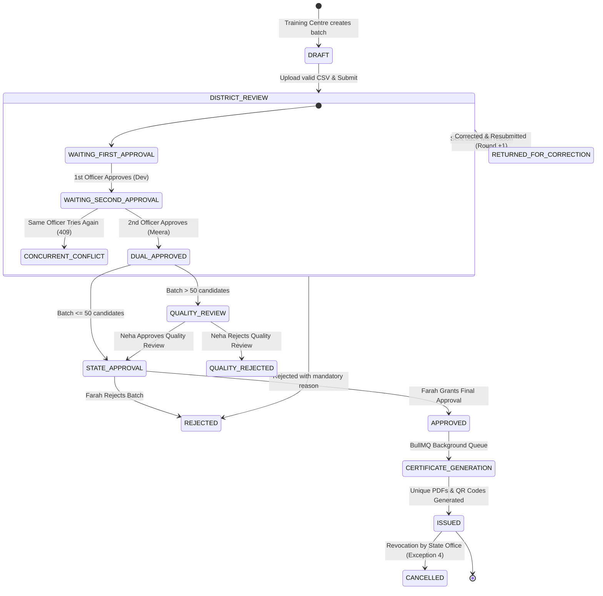

# CertiFlow &bull; Skilling Certificate Issuance Platform

> **Official Solution for the AlgoHire Company Hackathon**  
> *Developed for the Pragati Skills Mission &bull; Ministry of Skill Development & Entrepreneurship (Govt of India initiative)*

[](file:///e:/Downloads/portfolio_vamsi/certiflow/backend/tests)
[](file:///e:/Downloads/portfolio_vamsi/certiflow)
[](file:///e:/Downloads/portfolio_vamsi/certiflow/backend/tests/e2e_scenarios.test.ts)

---

## 1. Project Overview & Problem Statement

The **Pragati Skills Mission** is a digital skilling initiative operating across **300+ affiliated training centres** and certifying approximately **8,000 vocational candidates every month**.

### The Legacy Problem:
Before CertiFlow, the certification pipeline relied on manual spreadsheets shared via email, informal WhatsApp approvals, and ad-hoc certificate generation:
* **Spreadsheet Chaos:** Training centres frequently submitted spreadsheets with missing Aadhaar details, duplicate phone numbers, or invalid dates. Manual back-and-forth emails caused weeks of delays.
* **Approval Bottlenecks:** Single-point approvals created fraud vulnerabilities. High-volume batches passed through without quality sampling.
* **Manual Certificate Generation:** Certificates were typed manually into design templates, leading to typographical errors and duplicate certificate numbers.
* **Zero Real-Time Verification:** Employers had no automated way to verify whether a job applicant's certificate was authentic or forged.

### The CertiFlow Solution:
**CertiFlow** is an enterprise-grade digital certificate issuance, workflow governance, and public verification platform:
1. **Automated Spreadsheet Validation:** Universal CSV/Excel parser enforcing **all-or-nothing validation** with exact row and field error breakdown. No corrupted records ever touch the database.
2. **Dual-Officer District Governance:** Every batch requires independent approval from **two different district officers** before advancing.
3. **Threshold-Triggered Quality Audits:** Large batches exceeding 50 candidates are automatically routed to the State Quality Assurance team for randomized 10% sampling.
4. **State Final Issuance & Revocation Authority:** The State Office exercises final executive review and holds the authority to revoke fraudulent certificates with instant public registry invalidation.
5. **High-Performance Certificate Engine:** Background generation of tamper-evident landscape PDF certificates equipped with cryptographic verification codes and dynamic QR codes.
6. **Decoupled Notification Pipeline:** Simulated WhatsApp delivery with BullMQ queue retry mechanisms. Network timeouts never halt certificate issuance.
7. **Zero-Authentication Public Verification Portal:** Instant lookup protected by Redis L2 caching and strict Digital Personal Data Protection (DPDP) sanitization.

---

## 2. Mandatory Technology Stack

CertiFlow was constructed strictly with the contest-mandated technology stack:

| Component | Technology | Rationale & Implementation Details |
| :--- | :--- | :--- |
| **Backend Framework** | **Node.js + Express.js** | Industry-standard RESTful API server with modular routing, centralized error handlers, and strict HTTP semantics. |
| **Backend Language** | **TypeScript** (`tsx`) | Strict typing for domain models, workflow state machines, and API payloads. |
| **Database & ORM** | **PostgreSQL + Prisma ORM** | Relational integrity, foreign key cascades, migrations, and unique constraints preventing duplicate certificate issuance. |
| **Caching Layer** | **Redis (`ioredis`)** | Sub-millisecond L2 caching for public certificate verification with instant cache purge on revocation. |
| **Background Processing** | **BullMQ over Redis** | Asynchronous queues for PDF rendering and simulated WhatsApp notifications with exponential backoff retries. |
| **Containerization** | **Docker & Docker Compose** | Multi-container composition (`postgres`, `redis`, `backend`, `frontend`) for 1-click cloud and local deployment. |
| **Frontend Framework** | **React.js 18 + Vite** | High-performance SPA with pure JavaScript (JSX) for maintainable frontend code, Lucide icons, and zero heavy dependencies. |
| **Real-Time Stream** | **Server-Sent Events (SSE)** | Native HTTP streaming (`/api/events/stream`) pushing live status updates and alerts to connected dashboards. |
| **Testing** | **Vitest + Supertest** | 68 automated integration and end-to-end tests covering all 15 hackathon evaluation scenarios. |

---

## 3. System Architecture & Component Diagram

```
                                  [ Citizen / Employer ]
                                             │
                             Zero-Auth Public Verification (/verify)
                                             │
                                             ▼
┌───────────────────────────────────────────────────────────────────────────┐
│                           CERTIFLOW CLIENT (React)                        │
│  ┌───────────────────────┬──────────────────────┬──────────────────────┐  │
│  │ Training Centre (Anika)│ District (Dev/Meera) │ State Office (Farah) │  │
│  └───────────────────────┴──────────────────────┴──────────────────────┘  │
│  ┌───────────────────────┬──────────────────────┬──────────────────────┐  │
│  │ Quality Review (Neha) │ Candidate View (/cert)│ Real-Time SSE Stream │  │
│  └───────────────────────┴──────────────────────┴──────────────────────┘  │
└─────────────────────────────────────┬─────────────────────────────────────┘
                                      │ REST API / JWT / SSE
                                      ▼
┌───────────────────────────────────────────────────────────────────────────┐
│                         EXPRESS + TYPESCRIPT BACKEND                      │
│  ┌─────────────────────────────────────────────────────────────────────┐  │
│  │  Routes: /api/auth, /api/batches, /api/approvals, /api/state,       │  │
│  │          /api/certificates, /api/events                             │  │
│  └─────────────────────────────────────────────────────────────────────┘  │
│  ┌─────────────────────────┬──────────────────────┬───────────────────┐   │
│  │ Spreadsheet Validator   │ Workflow Controller  │ Credential Store  │   │
│  └─────────────────────────┴──────────────────────┴───────────────────┘   │
│  ┌─────────────────────────┬──────────────────────┬───────────────────┐   │
│  │ SSE Manager (Broadcast) │ PDFKit QR Generator  │ Cache Invalidation│   │
│  └─────────────────────────┴──────────────────────┴───────────────────┘   │
└──────────────────────┬───────────────────┬────────────────────┬───────────┘
                       │                   │                    │
                       ▼                   ▼                    ▼
             ┌──────────────────┐ ┌─────────────────┐ ┌──────────────────┐
             │  PostgreSQL DB   │ │   Redis Cache   │ │ BullMQ & Workers │
             │   (Prisma ORM)   │ │  & Invalidation │ │ (PDF & WhatsApp) │
             └──────────────────┘ └─────────────────┘ └──────────────────┘
```

---

## 4. Demo Personas & Pre-Seeded Evaluation Accounts

The platform includes a persistent **Persona Switcher** bar at the top of the screen allowing instant switching between predefined accounts during hackathon evaluation:

| Persona | Name | Role | Scope / Assigned Entity | Password | Key Permissions & Responsibilities |
| :--- | :--- | :--- | :--- | :--- | :--- |
| **Anika** | Anika Sharma | `TRAINING_CENTRE` | Apex Skill Development Centre (Bhopal) | `password123` | Create batches, upload CSV/Excel, inspect errors, submit for review, resubmit corrected batches. |
| **Dev** | Dev Verma | `DISTRICT_OFFICER` | Bhopal District Office | `password123` | Inspect batches, record 1st district approval, reject with reason, return for correction. |
| **Meera** | Meera Nair | `DISTRICT_OFFICER` | Bhopal District Office | `password123` | Inspect batches, record 2nd distinct district approval, reject with reason, return for correction. |
| **Kabir** | Kabir Das | `DISTRICT_OFFICER` | Bhopal District Office | `password123` | Alternate 2nd district officer for dual-approval concurrency. |
| **Neha** | Neha Gupta | `QUALITY_TEAM` | State Quality Assurance Directorate | `password123` | Inspect large batches (> 50 candidates), conduct 10% sampling audits, approve/reject quality reviews. |
| **Farah** | Farah Khan | `STATE_OFFICE` | State Project Directorate (Executive) | `password123` | Final issuance approval, SLA overdue monitoring, certificate revocation (Exception 4), audit log explorer. |

---

## 5. End-to-End Approval Workflow State Machine

CertiFlow implements a deterministic, multi-stage state machine enforcing all governance rules:



### The 10 Workflow Statuses:
1. `DRAFT`: Initial batch state. Training centre edits metadata and uploads spreadsheets.
2. `SUBMITTED`: Transition state upon submission.
3. `DISTRICT_REVIEW`: Under review by assigned district officers. Requires 2 distinct approvals.
4. `RETURNED_FOR_CORRECTION`: Batch returned to centre due to discrepancies; centre edits and resubmits to start Round 2.
5. `DISTRICT_APPROVED`: Dual district approval satisfied.
6. `QUALITY_REVIEW`: Automatically triggered for large batches (`> 50` candidates).
7. `QUALITY_REJECTED`: Quality team identified audit irregularities.
8. `STATE_APPROVAL`: Executive review by State Directorate.
9. `APPROVED`: Final approval granted; certificate generation job enqueued.
10. `ISSUED`: Certificates generated, PDFs stored, WhatsApp notifications dispatched.
11. `REJECTED`: Permanently rejected by District or State Office.
12. `CANCELLED`: Issued certificate revoked by State Office directive.

---

## 6. The 4 Mandatory Hackathon Edge Case Exceptions

### Exception 1: All-or-Nothing Spreadsheet Validation
* **Problem:** Saving partially valid batches corrupts training mission statistics and leaves invalid candidates stranded.
* **CertiFlow Solution:** Universal parser (`validators/spreadsheet.validator.ts`) parses CSV/Excel files and validates every single row before touching the database.
* **Behavior:** If even 1 record fails validation (e.g. 9-digit phone number, invalid Aadhaar, future date), the entire batch is rejected with HTTP `422 Unprocessable Entity`.
* **Output:** Exact row number, column name, invalid value, and explanation:
  ```json
  {
    "success": false,
    "error": "INVALID_SPREADSHEET",
    "details": {
      "totalRows": 100,
      "validRows": 98,
      "invalidRows": 2,
      "errors": [
        { "row": 14, "field": "mobileNumber", "error": "Must be valid 10-digit Indian phone number starting with 6-9." },
        { "row": 42, "field": "aadhaarLast4", "error": "Must be exactly 4 digits." }
      ]
    }
  }
  ```

### Exception 2: Dual-Officer Concurrency & Anti-Duplicate Approval
* **Problem:** In a busy district office, an officer might click "Approve" twice or approve their own prior submission.
* **CertiFlow Solution:** The database schema enforces a composite unique constraint: `@@unique([batchId, userId, round])`.
* **Behavior:**
  - When Dev records approval #1, the batch remains in `DISTRICT_REVIEW` with `approvalsCount = 1`.
  - If Dev attempts to approve the batch again, the backend intercepts the request and responds with **`409 Conflict`**:  
    `"Officer Dev Verma has already approved this batch for Round 1. A different district officer must provide the second approval."`
  - Only when a second distinct officer (e.g. Meera or Kabir) approves does the batch progress.

### Exception 3: Decoupled Simulated WhatsApp Notification Pipeline
* **Problem:** Telecom provider downtime or carrier rate-limits must NEVER block certificate generation.
* **CertiFlow Solution:** Certificate issuance and WhatsApp delivery are completely decoupled via **BullMQ background queues**.
* **Behavior:**
  1. High-resolution PDF generation executes immediately and marks the certificate as `ISSUED`.
  2. The notification event is dispatched asynchronously to `whatsappQueue` in BullMQ.
  3. The `MockWhatsAppService` simulates real carrier conditions: telecom propagation delay (1,000 ms) and random 20% carrier gateway timeouts.
  4. Failed deliveries automatically retry with exponential backoff up to 3 attempts.
  5. Even if the simulated WhatsApp delivery times out, **the candidate's certificate is already securely generated, issued, and downloadable**.

### Exception 4: Certificate Revocation with Preserved Audit Trails & Instant Cache Invalidation
* **Problem:** If a certificate was issued based on falsified training records, it must be cancelled immediately without destroying legal evidence.
* **CertiFlow Solution:**
  1. The database record is **never deleted**. Status updates to `CANCELLED`, recording `cancellationReason`, `cancelledAt`, and `cancelledByUserId`.
  2. The physical PDF file on disk is preserved for legal compliance.
  3. **Instant Cache Purge:** The backend immediately invalidates `cert:verify:<CERT_NO>` and `cert:verify:<VRF_CODE>` in Redis.
  4. Any citizen or employer checking `/verify` immediately sees a prominent red **"OFFICIALLY REVOKED / CANCELLED"** warning with the exact cancellation reason.

---

## 7. Public Verification & Candidate Access Portals

### 1. Zero-Authentication Public Verification Portal (`/verify`)
* Accessible without logging in.
* Accepts either **Certificate Registration Number** (e.g. `PSM-2026-BPL-OFAP-0001`) or **QR Verification Code** (e.g. `VRF-ROH-8899-VALID`).
* Features **Hackathon Evaluator Quick-Test Presets** to test authentic, revoked, and non-existent credentials in 1 click.
* **Strict Privacy Shield (DPDP Act):** The public endpoint strictly scrubs personal contact numbers, guardian names, and Aadhaar numbers. Exposes only qualification status, candidate name, course, training centre, and issue date.
* **Redis Caching:** Sub-millisecond response (`fromCache: true`) on repeat verifications.

### 2. Candidate Private Credential Portal (`/certificate/:token`)
* Accessible via personal secure access link delivered via WhatsApp (e.g. `/certificate/tok_rohan_valid_access_key_9988`).
* Cryptographically linked to the candidate's unique record; forged tokens are rejected with `404 Not Found`.
* Features a high-fidelity government certificate visual canvas and a one-click **"Download Official PDF"** button streaming the binary PDF from `/api/certificates/download/:token`.

---

## 8. Complete API Endpoint Catalog

All routes run under the `/api` prefix:

### Authentication (`/api/auth`)
| Method | Endpoint | Auth | Description |
| :--- | :--- | :--- | :--- |
| `POST` | `/api/auth/demo-login` | Public | Instant 1-click persona login (`anika`, `dev`, `meera`, `kabir`, `neha`, `farah`). |
| `POST` | `/api/auth/login` | Public | Standard email/password login. |
| `GET` | `/api/auth/me` | Bearer JWT | Returns current authenticated user profile & permissions. |
| `POST` | `/api/auth/logout` | Bearer JWT | Clears session cookie/token. |

### Batch Management (`/api/batches`)
| Method | Endpoint | Auth / Role | Description |
| :--- | :--- | :--- | :--- |
| `POST` | `/api/batches` | `TRAINING_CENTRE` | Creates a new batch in `DRAFT` status. |
| `POST` | `/api/batches/validate-spreadsheet` | `TRAINING_CENTRE` | Dry-run all-or-nothing spreadsheet validator. |
| `POST` | `/api/batches/:id/upload` | `TRAINING_CENTRE` | Validates & imports CSV/Excel candidates to batch. |
| `POST` | `/api/batches/:id/submit` | `TRAINING_CENTRE` | Submits batch, transitioning status to `DISTRICT_REVIEW`. |
| `GET` | `/api/batches` | Authenticated | Lists batches scoped to the user's role and district. |
| `GET` | `/api/batches/:id` | Authenticated | Retrieves batch details with candidate list and approval history. |
| `PUT` | `/api/batches/:id/candidates/:cid` | `TRAINING_CENTRE` | Edits candidate details on a returned batch. |
| `POST` | `/api/batches/:id/resubmit` | `TRAINING_CENTRE` | Resubmits batch after corrections, incrementing approval round. |
| `GET` | `/api/batches/stats` | `TRAINING_CENTRE` | Training centre dashboard statistics. |

### District & Quality Approvals (`/api/approvals`)
| Method | Endpoint | Auth / Role | Description |
| :--- | :--- | :--- | :--- |
| `GET` | `/api/approvals/district/dashboard` | `DISTRICT_OFFICER` | District officer dashboard (pending batches, stats, overdue SLA). |
| `POST` | `/api/approvals/batches/:id/approve` | `DISTRICT_OFFICER` | Records district approval (enforcing 2 distinct officers). |
| `POST` | `/api/approvals/batches/:id/reject` | `DISTRICT_OFFICER` | Rejects batch with mandatory reason (min 5 chars). |
| `POST` | `/api/approvals/batches/:id/return` | `DISTRICT_OFFICER` | Returns batch for correction with mandatory reason. |
| `GET` | `/api/approvals/quality/dashboard` | `QUALITY_TEAM` | Quality review dashboard (large batches > 50 candidates). |
| `POST` | `/api/approvals/quality/:id/approve` | `QUALITY_TEAM` | Approves quality audit, advancing batch to `STATE_APPROVAL`. |
| `POST` | `/api/approvals/quality/:id/reject` | `QUALITY_TEAM` | Rejects quality review with audit reason. |

### State Office Governance (`/api/state`)
| Method | Endpoint | Auth / Role | Description |
| :--- | :--- | :--- | :--- |
| `GET` | `/api/state/dashboard` | `STATE_OFFICE` | State overview (pending final approval, overdue SLA batches, stats). |
| `POST` | `/api/state/batches/:id/approve` | `STATE_OFFICE` | Final state approval; enqueues background certificate generation. |
| `POST` | `/api/state/batches/:id/reject` | `STATE_OFFICE` | Final rejection with mandatory directive reason. |
| `POST` | `/api/state/certificates/:id/cancel` | `STATE_OFFICE` | Revokes certificate (Exception 4) & invalidates Redis cache. |
| `GET` | `/api/state/certificates` | `STATE_OFFICE` | Master certificate register (issued & revoked credentials). |
| `GET` | `/api/state/audit-logs` | `STATE_OFFICE` | Append-only audit log explorer with action and date filters. |

### Certificate Verification & Download (`/api/certificates`)
| Method | Endpoint | Auth | Description |
| :--- | :--- | :--- | :--- |
| `GET` | `/api/certificates/verify/:id` | **Public** | Zero-auth public verification lookup with DPDP data masking. |
| `GET` | `/api/certificates/access/:token` | **Public (Token)** | Candidate direct access by unique private signed token. |
| `GET` | `/api/certificates/download/:token` | **Public (Token)** | Streams high-resolution binary PDF file for download. |
| `POST` | `/api/certificates/generate/:batchId` | Authenticated | Trigger certificate generation (strictly idempotent). |
| `GET` | `/api/certificates/notifications` | Authenticated | Simulated WhatsApp delivery logs and retry statistics. |

### Real-Time Event Stream (`/api/events`)
| Method | Endpoint | Auth | Description |
| :--- | :--- | :--- | :--- |
| `GET` | `/api/events/stream` | **Public / Client** | Server-Sent Events (SSE) stream for live updates. |
| `GET` | `/api/events/status` | Public | Returns connected SSE client count and stream health. |

---

## 9. 15/15 Hackathon Evaluation Scenarios Verification Matrix

All 15 evaluation scenarios are covered by automated end-to-end integration tests in [`tests/e2e_scenarios.test.ts`](file:///e:/Downloads/portfolio_vamsi/certiflow/backend/tests/e2e_scenarios.test.ts):

| Scenario # | Hackathon Evaluation Scenario | Automated Test File | Status | Verification Detail |
| :---: | :--- | :--- | :---: | :--- |
| **1** | Persona Login & RBAC Protection | `tests/auth.test.ts`<br>`tests/e2e_scenarios.test.ts` | **PASSED** | Training centre blocked from district APIs (403); district officer blocked from creating batches (403); unauthenticated blocked (401). |
| **2** | Batch Creation in `DRAFT` Status | `tests/batch.test.ts`<br>`tests/e2e_scenarios.test.ts` | **PASSED** | Anika creates batch in `DRAFT` with initial candidate count = 0. |
| **3** | All-or-Nothing Spreadsheet Validation (Exception 1) | `tests/batch.test.ts`<br>`tests/e2e_scenarios.test.ts` | **PASSED** | Spreadsheet with 1 invalid row rejected with 422; exact row/field reported; 0 records saved. |
| **4** | Batch Submission to `DISTRICT_REVIEW` | `tests/batch.test.ts`<br>`tests/e2e_scenarios.test.ts` | **PASSED** | Uploads valid candidates, submits batch, status transitions to `DISTRICT_REVIEW`. Double submit blocked (400). |
| **5** | 1st District Officer Approval (Dev) | `tests/approval.test.ts`<br>`tests/e2e_scenarios.test.ts` | **PASSED** | Dev approves batch; status remains `DISTRICT_REVIEW` awaiting second approval. |
| **6** | Anti-Duplicate Approval Prevention | `tests/approval.test.ts`<br>`tests/e2e_scenarios.test.ts` | **PASSED** | Dev attempting to approve same batch a second time rejected with **409 Conflict**. |
| **7** | 2nd District Officer Approval (Meera) | `tests/approval.test.ts`<br>`tests/e2e_scenarios.test.ts` | **PASSED** | Meera provides 2nd approval; batch satisfies dual-approval condition. |
| **8** | Threshold Routing: Small Batch (`<= 50`) | `tests/approval.test.ts`<br>`tests/e2e_scenarios.test.ts` | **PASSED** | Small batch (2 candidates) bypasses quality review directly to `STATE_APPROVAL`. |
| **9** | Threshold Routing: Large Batch (`> 50`) | `tests/approval.test.ts`<br>`tests/e2e_scenarios.test.ts` | **PASSED** | Large batch (55 candidates) automatically routes to `QUALITY_REVIEW`. |
| **10** | Quality Team Review & Approval (Neha) | `tests/approval.test.ts`<br>`tests/e2e_scenarios.test.ts` | **PASSED** | Neha approves quality audit with notes; batch advances to `STATE_APPROVAL`. |
| **11** | Return for Correction & Round Increment | `tests/approval.test.ts`<br>`tests/e2e_scenarios.test.ts` | **PASSED** | Batch returned with mandatory reason (status `RETURNED_FOR_CORRECTION`); resubmission increments to Round 2. |
| **12** | State Office Final Issuance Approval (Farah) | `tests/state.test.ts`<br>`tests/e2e_scenarios.test.ts` | **PASSED** | Farah approves batch; status advances to `APPROVED` and certificate generation is enqueued. |
| **13** | Idempotent Certificate Generation | `tests/certificate.test.ts`<br>`tests/e2e_scenarios.test.ts` | **PASSED** | Unique certificates (`PSM-2026-...`), QR codes, and PDFs generated. Re-running creates 0 duplicates. |
| **14** | Decoupled Simulated WhatsApp Notification (Exception 3) | `tests/certificate.test.ts`<br>`tests/e2e_scenarios.test.ts` | **PASSED** | WhatsApp delivery receipts generated; telecom timeouts/retries never block certificate issuance. |
| **15** | Public Verification, Privacy Masking & Revocation (Exception 4) | `tests/verification_cache.test.ts`<br>`tests/e2e_scenarios.test.ts` | **PASSED** | Public verification returns sanitized data; cached in Redis; revocation immediately purges cache; candidate PDF download verified. |

---

## 10. Running Automated Tests

To run the complete automated test suite (all 8 test files, 68 tests):

```bash
cd certiflow/backend
npm test
```

Expected output:
```
 ✓ tests/health.test.ts (1 test)
 ✓ tests/auth.test.ts (12 tests)
 ✓ tests/batch.test.ts (8 tests)
 ✓ tests/approval.test.ts (8 tests)
 ✓ tests/state.test.ts (7 tests)
 ✓ tests/certificate.test.ts (7 tests)
 ✓ tests/verification_cache.test.ts (10 tests)
 ✓ tests/e2e_scenarios.test.ts (15 tests)

 Test Files  8 passed (8)
      Tests  68 passed (68)
   Duration  ~3.25s
```

To run the frontend production build:
```bash
cd certiflow/frontend
npm run build
```

Expected output:
```
vite v6.4.6 building for production...
✓ 1666 modules transformed.
dist/index.html                   0.73 kB
dist/assets/index-Ca3z9mEl.js   350.46 kB
✓ built in 2.10s with 0 errors
```

---

## 11. Quick Demonstration Guide for Evaluators

1. **Launch Backend & Frontend:**
   - In terminal 1: `cd certiflow/backend && npm run dev` (Runs on `http://localhost:5000`)
   - In terminal 2: `cd certiflow/frontend && npm run dev` (Runs on `http://localhost:5173`)
2. **Access Evaluation Portal:**
   - Open browser to `http://localhost:5173`.
3. **Test Role 1: Anika (Training Centre):**
   - Click **"Anika (Training Centre)"** in the top bar.
   - Click **"Create New Batch"** &rarr; Name: "Electrician Batch 2026", Code: "ELEC-2026".
   - Click **"Download Sample Template"** &rarr; Upload `sample_valid.csv`.
   - Click **"Submit Batch"** &rarr; Status changes to `DISTRICT_REVIEW`.
4. **Test Role 2: Dev (District Officer 1):**
   - Switch persona to **"Dev"**.
   - Open the submitted batch &rarr; click **"Approve Batch"**.
   - Notice: Approvals count changes to **1/2 District Approvals**.
   - Click "Approve Batch" again &rarr; system notifies: *"You have already approved this batch."*
5. **Test Role 3: Meera (District Officer 2):**
   - Switch persona to **"Meera"**.
   - Open the same batch &rarr; click **"Approve Batch"**.
   - Notice: Approvals count reaches **2/2**; batch automatically advances to `STATE_APPROVAL`.
6. **Test Role 4: Farah (State Office):**
   - Switch persona to **"Farah"**.
   - Go to **"Batches Pending Final Approval"** &rarr; click **"Grant Final Approval"**.
   - Status updates to `APPROVED` and `ISSUED`.
   - Open **"Certificate Revocation Console"** to see all issued certificates.
7. **Test Public Verification (`/verify`):**
   - Click **"🔍 Public Verify"** in the top right.
   - Click **"✓ Authentic Cert (Rohan Sharma)"** &rarr; see green verified credential card.
   - Click **"⚠ Revoked Cert (Vikram Aditya)"** &rarr; see red revocation warning with cancellation reason.
8. **Test Candidate PDF Download:**
   - Navigate to `/certificate/tok_rohan_valid_access_key_9988`.
   - Click **"Download Official PDF"** &rarr; instantly downloads high-resolution PDF certificate with QR code!
